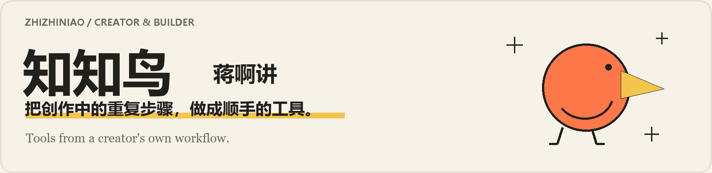
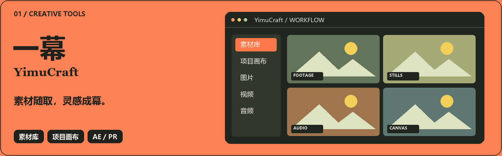
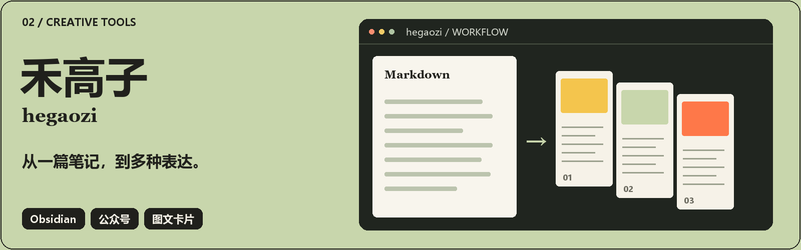
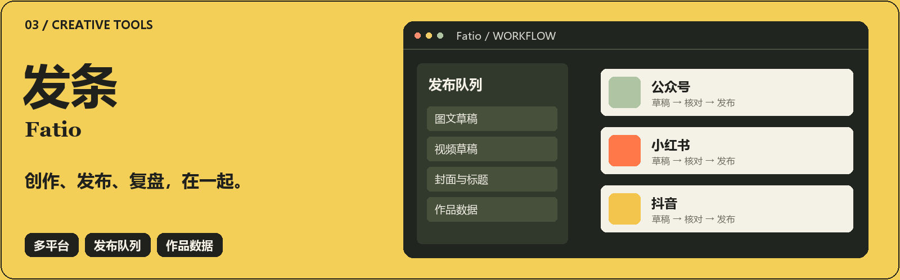
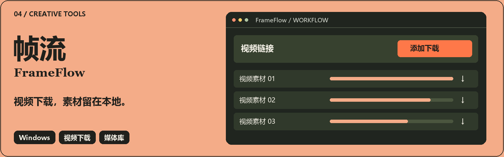

**做了近 20 年影视后期，现在用 AI 做工具，也做内容。** 从素材整理、图文排版到发布复盘，持续打磨自己用得上的创作流程。

A video creator building practical tools with AI — for media, writing, publishing, and the work in between.

[一幕 YimuCraft](#一幕-yimucraft) · [禾高子](#禾高子) · [发条 Fatio](#发条-fatio) · [帧流 FrameFlow](#帧流-frameflow)

---

## 一幕 YimuCraft

**素材随取，灵感成幕。** 面向视频创作者的 Windows 本地素材库：整理图片、视频与音频，用项目画布组织素材，并与 After Effects / Premiere Pro 联动。

A local media library and project canvas for video creators, with After Effects and Premiere Pro integration.

[**查看项目 →**](https://github.com/zhizhiniao/YimuCraft) · [下载开发者预览版](https://github.com/zhizhiniao/YimuCraft/releases) · [使用说明](https://github.com/zhizhiniao/YimuCraft/blob/main/docs/USAGE.md)

---

## 禾高子

**从一篇 Markdown 笔记，准备公众号文章、图文卡片和多平台草稿。** 写作留在 Obsidian，排版、配图与平台草稿接着完成。基于 WeSight 持续修改，沿用 AGPL-3.0-or-later 许可证。

An Obsidian plugin for WeChat article layouts, image cards, and platform-specific drafts. Based on WeSight.

[**查看项目 →**](https://github.com/zhizhiniao/hegaozi) · [下载安装](https://github.com/zhizhiniao/hegaozi/releases) · [演示与使用](https://github.com/zhizhiniao/hegaozi#演示与优化案例)

---

## 发条 Fatio

**把创作、发布和复盘，放在一张工作台。** 面向个人创作者的 Windows 本地发布工具，集中管理多平台账号、图文与视频草稿、发布队列和作品数据。按平台准备，发布前核对。

A local Windows workspace for multi-platform drafts, publishing queues, and content performance.

[**查看项目 →**](https://github.com/zhizhiniao/Fatio) · [下载开发者预览版](https://github.com/zhizhiniao/Fatio/releases) · [使用说明](https://github.com/zhizhiniao/Fatio/blob/main/docs/USAGE.md)

---

## 帧流 FrameFlow

**视频下载与本地媒体库，放在一起。** Windows 桌面工具，集中下载与管理视频素材，支持检查应用更新。

A Windows video downloader and local media library, with app update checks.

[**查看项目 →**](https://github.com/zhizhiniao/FrameFlow) · [下载 Windows 版](https://github.com/zhizhiniao/FrameFlow/releases/latest)

---

这些工具来自我的日常创作，也会继续在使用中改进。欢迎到各项目提交问题和建议。

> 一幕、发条为开发者预览版；禾高子持续迭代中。功能、适用范围及版本状态以各项目说明为准。卡片中的界面为功能示意。
